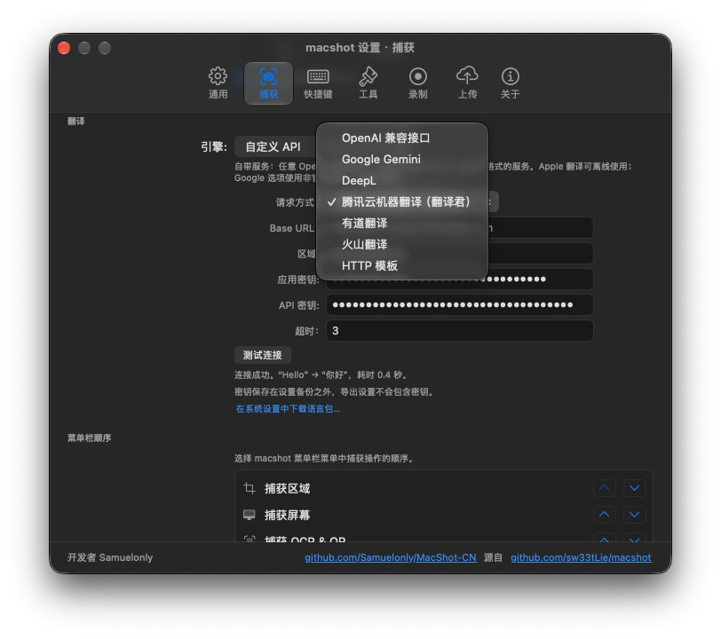
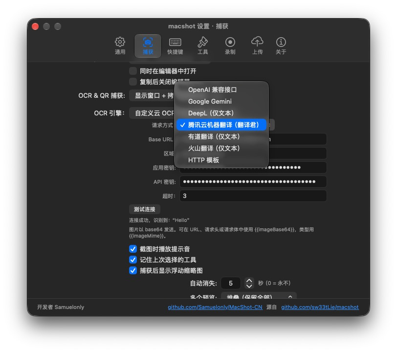

# macshot（中文增强版 · MacShot-CN）

> **这是 [sw33tLie/macshot](https://github.com/sw33tLie/macshot) 的中文修改版。**
> 原版的 OCR 与翻译调用 Google，在国内又慢又经常不可用。本版把这两条链路改成可自填密钥的第三方 API：OpenAI 兼容接口、Google Gemini、DeepL、腾讯云机器翻译、有道翻译、火山翻译，以及通用 HTTP 模板。OCR 也走同一套供应商列表，腾讯云可直接识别图片。

<p align="center">
  
  
</p>

### 与上游的差异

- **自带密钥（BYOK）** —— 翻译与 OCR 各有一套独立配置：引擎、Base URL、区域、密钥、超时（1–10 秒，默认 3 秒），并可一键测试连通性。密钥保存在本机的 `~/Library/Application Support/macshot/ai-secrets.json`（权限 0600），不写进设置备份。
- **腾讯云** —— 翻译走 TMT（TC3-HMAC-SHA256 签名），OCR 走 `GeneralBasicOCR`；自动压在每秒 4 次的官方频率上限内，撞限会退避重试。
- **有道 / 火山 / DeepL** —— 各自的原生签名与协议，不依赖第三方中转。
- **国内可用** —— 不再依赖 Google 的翻译与 OCR 端点。
- **界面** —— 设置窗口加宽到 700pt，顶部页签居中，长中文文案不再溢出。

### 想接自己的服务？

**大多数情况不用改代码。** 翻译和 OCR 的引擎下拉里都有「HTTP 模板」这一项，把对方接口的 Method、URL、Headers、Body 和响应路径填进去就行，用这几个占位符做插值：

| 占位符 | 含义 |
| --- | --- |
| `{{text}}` | 待翻译的原文 |
| `{{key}}` | 本页填的密钥 |
| `{{to}}` / `{{from}}` | 目标 / 源语言代码，`from` 为 `auto` 时表示自动识别 |
| `{{imageBase64}}` | 截图的 base64（OCR 用） |
| `{{imageMime}}` | 图片类型，通常是 `image/png` |

比如某家服务要这样的请求体：

```json
{ "q": "{{text}}", "target": "{{to}}", "key": "{{key}}" }
```

响应路径用点号表示，比如 `data.translations.0.text`，就能把结果取出来。只要对方是同步的 JSON 接口，不写一行 Swift 也能接上。

**想原生支持一家厂商**（需要签名、特殊编码或批量协议）才要改源码，三步：

1. 在 `macshot/Services/AIProvider.swift` 的 `Mode` 里加一个 case 和 `title`，并加进 `orderedCases`；
2. 写一个 `sendXxx` 发送函数，在 `translate` 和 `recognizeText` 两个 switch 里各加一条分支；
3. 在 `en.lproj` / `zh-Hans.lproj` 的 `Localizable.strings` 补上引擎名字，缺了会被 `LocalizationTests` 拦下。

配置界面对翻译和 OCR 是同一个组件（`AIProviderEditor`），所以加一个引擎，两处下拉会自动同步。

---
<p align="center">
  
</p>

<p align="center">
  <b>The most feature-rich open-source screenshot tool on macOS.</b><br>
  <br>
  19+ annotation tools, screen recording with a full video editor, OCR + translation,<br>
  auto-redact PII, scroll capture, beautify — all native, all free.
</p>

<p align="center">
  <a href="https://github.com/Samuelonly/MacShot-CN/releases/latest">Download</a> · <a href="https://github.com/sw33tLie/macshot/blob/main/CHANGELOG.md">Changelog</a> · <a href="https://github.com/sw33tLie/macshot/blob/main/PRIVACY.md">Privacy</a> · <a href="https://github.com/sw33tLie/macshot/blob/main/SECURITY.md">Security</a>
</p>

<p align="center">
  
</p>

<p align="center">
  
</p>

---

### Why macshot?

- **Capture & annotate in one flow** — select a region, draw arrows/text/shapes/blur, copy to clipboard. One hotkey, zero friction.
- **Screen recording with built-in editor** — record any area or full screen as MP4/GIF with system audio + microphone. Audio merge dialog with per-track volume control. Trim and export without leaving the app.
- **Scroll capture** — select a region and scroll. macshot stitches it into one seamless tall (or wide) image automatically.
- **Upload anywhere** — one-click upload to Google Drive, imgbb, or any S3-compatible service (Cloudflare R2, AWS S3, MinIO, etc.). Link copied to clipboard instantly.
- **Lightweight & native** — lives in your menu bar. Built with Swift and AppKit, not a web browser in disguise.
- **40 languages** — English, 中文, 日本語, 한국어, Deutsch, Français, Español, Italiano, Português, العربية, हिन्दी, and 29 more. Auto-detects your system language.

---

## Install

**Homebrew:**
```bash
brew install --cask macshot
```

**Manual:** Download the latest `.dmg` from [Releases](https://github.com/sw33tLie/macshot/releases), open it, drag to `/Applications`.

---

## Quick Start

1. Launch macshot — it appears in your menu bar
2. Press `Cmd+Shift+X` to capture
3. Drag to select, annotate with the toolbar, press `Cmd+C` to copy
4. Press `Esc` to cancel

---

<details>
<summary><b>All Features</b></summary>

### Capture
- **Instant capture** — global hotkey freezes your screen, select any region
- **Window snap** — hover over a window and click to capture it exactly; `Tab` toggles snap, `F` for full screen
- **Resolution & aspect presets** — set an exact pixel size or lock an aspect ratio (1:1, 4:3, 16:9, 9:16, …) before or after selecting; editable width/height fields
- **Boundary snap** — selection edges snap to strong color edges (UI lines, window borders) while dragging or resizing; hold `Option` to bypass
- **Scroll capture** — auto-detects vertical or horizontal scrolling, stitches with Apple Vision, live preview panel beside the capture region
- **Capture delay** — 3/5/10/30 second countdown before capture, set via menu bar. Escape to cancel.
- **Multi-monitor** — captures all screens simultaneously; drag a selection across screens for a stitched image
- **Quick save** — `Cmd+Shift+S` to select and save/copy instantly without annotation. Enter key also saves/copies based on preference.
- **Quick OCR** — `Cmd+Shift+T` to select and extract text instantly

### Annotation Tools
- **Arrow** — 5 styles: single, thick/banner, double, open, tail; flip direction toggle; right-click to add anchor points for complex curves
- **Shapes** — rectangle and ellipse with 3 fill modes (stroke, stroke+fill, fill), corner radius slider
- **Text** — rich formatting (bold/italic/underline/strikethrough), resizable text box, left/center/right alignment, background fill & outline colors, click to re-edit
- **Pencil & Marker** — freeform drawing with optional smoothing; smart marker mode snaps to text lines via OCR
- **Numbered markers** — auto-incrementing (1/I/A/a formats), with optional pointer cone
- **Stamp / Emoji** — 21 quick emojis, 100+ in categorized picker, or load any image
- **Censor (Pixelate / Blur / Solid / Erase)** — unified redaction tool with 4 modes: pixelate, Gaussian blur, solid color fill, or smart erase that samples surrounding colors for invisible content removal. Auto-redact PII (emails, phones, credit cards, SSNs, API keys), auto-detect faces and people, or draw in "Text Only" mode to censor just the text in a region
- **Measure** — pixel ruler with px/pt toggle; hold `1` or `2` for auto-measure
- **Loupe** — 2x magnifier
- **Highlight (spotlight)** — drag a region to keep it bright while dimming the rest; adjustable dim strength and solid/dashed border
- **Color sampler** — eyedropper to pick any color; right-click to copy hex; auto-saves to custom palette slots
- **Space to reposition** — hold Space while drawing to move the shape without changing its size
- **Rotation** — rotate shapes via handle, Shift for 90° snaps
- **Click-to-select** — click any annotation to select it, then edit properties (stroke, style, fill), drag to move, resize via handles, rotate, or delete — all without switching tools

### Screen Recording
- **MP4 (H.264)** up to 120fps or **GIF** (5/10/15fps)
- **System audio capture** — toggle on/off, excludes macshot's own sounds
- **Microphone recording** — record voice narration alongside screen capture (permission requested on first use)
- **Mouse click highlights** — visual ripple on clicks during recording
- **Selection border** — visible capture region outline during recording
- **Menu bar stop button** — stop recording from the menu bar icon (appears even if icon is hidden)
- **Quick settings popover** — change format, FPS, and post-recording action on the fly without opening Preferences
- **Video editor** — trim timeline, mute/strip audio, play/pause, save (with Save As), upload, reveal in Finder

### Output & Upload
- **Formats** — PNG, JPEG, HEIC, WebP, AVIF with quality slider
- **Google Drive** — sign in once, uploads to a private folder (defaults to "macshot", configurable in Settings)
- **imgbb** — anonymous image hosting with shareable links
- **S3-compatible** — upload to Cloudflare R2, AWS S3, MinIO, DigitalOcean Spaces, Backblaze B2, etc.
- **Retina downscale** — optional 1x export for smaller files
- **sRGB color profile** — optional embedding for cross-display consistency

### Editor Window
- Standalone resizable window with full annotation tools, beautify preview
- **Add Capture** — capture additional screen regions and compose them into a single image, drag to reposition
- **Paste image** — `Cmd+V` drops a clipboard image into the canvas as a draggable layer
- Crop (with rule-of-thirds grid), flip H/V, zoom 0.1x–8x
- Top bar with pixel dimensions, zoom dropdown (presets, fit canvas, zoom in/out)

### Beautify
- macOS window frame with traffic lights, shadow, and gradient background
- 30 gradient styles including 7 mesh gradients (macOS 15+), adjustable padding/corner radius/shadow

### Image Effects (Adjust)
- Non-destructive CIFilter adjustments: Brightness, Contrast, Saturation, Sharpness
- 8 presets: Noir, Mono, Sepia, Chrome, Fade, Instant, Vivid
- Works independently or combined with Beautify
- Live preview in the overlay

### Other
- **OCR & QR** — extract text with Apple Vision (auto-detects all languages on macOS 13+), auto-copy to clipboard, translate to 30+ languages, Google AI Search; also reads QR codes with open/copy/scan actions
- **Invert colors** — one-click color inversion, apply twice to revert
- **Background removal** — Apple Vision foreground mask (macOS 14+)
- **Pin to screen** — floating always-on-top window
- **Floating thumbnail** — auto-dismiss preview with Copy/Save/Pin/Edit/Upload
- **Screenshot history with editable annotations** — menu bar submenu + drop-down history panel (`Cmd+Shift+H`). Re-open any capture in the editor with live annotations preserved — edit, then press Done to save back. Drag-and-drop, Quick Look, and right-click actions
- **QR & barcode detection** — inline Open/Copy actions
- **Snap alignment guides** — annotations snap to midlines and edges
- **Liquid Glass theme** (macOS 26 Tahoe) — render toolbars, popovers, and HUDs as Apple's translucent Liquid Glass material
- **Custom menu bar icon** — use the default, a built-in preset, or any SF Symbol
- **Auto-updates** via Sparkle

</details>

<details>
<summary><b>Keyboard Shortcuts</b></summary>

**Global hotkeys** (configurable in Preferences)

| Shortcut | Action |
|---|---|
| `Cmd+Shift+X` | Capture Area |
| `Cmd+Shift+F` | Capture Full Screen |
| `Cmd+Shift+S` | Quick Capture (instant save) |
| `Cmd+Shift+T` | Capture OCR (instant text extraction) |
| `Cmd+Shift+R` | Record Area |
| `Cmd+Shift+H` | Show History Panel |

**General** (during capture)

| Shortcut | Action |
|---|---|
| `Enter` | Confirm (save or copy based on preference) |
| `Cmd+C` | Copy to clipboard |
| `Cmd+S` | Save to file |
| `Cmd+Z` / `Cmd+Shift+Z` | Undo / Redo |
| `Cmd+0` | Reset zoom to 1x |
| `Esc` | Cancel / close popover |
| `Delete` | Remove selected annotation |
| `Tab` | Toggle window snap mode |
| `F` | Capture full screen (snap mode) |
| `Shift` (while drawing) | Constrain to straight lines / perfect shapes |
| `Space` (while drawing) | Reposition shape without changing size |
| `Right-click` on line/arrow | Add anchor point for multi-point curves |

**Tool shortcuts** (active after selecting a region — customizable in Preferences > Shortcuts)

| Key | Tool |
|---|---|
| `A` | Arrow |
| `L` | Line |
| `P` | Pencil |
| `M` | Marker |
| `R` | Rectangle |
| `O` | Ellipse |
| `T` | Text |
| `N` | Number |
| `B` | Censor (Pixelate/Blur) |
| `H` | Highlight (spotlight) |
| `I` | Color Sampler |
| `G` | Stamp / Emoji |
| `S` | Select & Edit |
| `E` | Open in Editor |

</details>

---

## Permissions

macshot requires **Screen Recording** permission. macOS will prompt you on first capture.

---

## Donations

Thanks for thinking about it, but macshot doesn't take donations. I make this in my free time and I'm happy to keep it that way, so there's no "buy me a coffee" or sponsorship link.

If you'd like to help out, starring the repo, reporting bugs, or contributing is more than enough. Thank you! 🙏

---

## Requirements

macOS 12.3 (Monterey) or later.

## License

[GPLv3](LICENSE)
